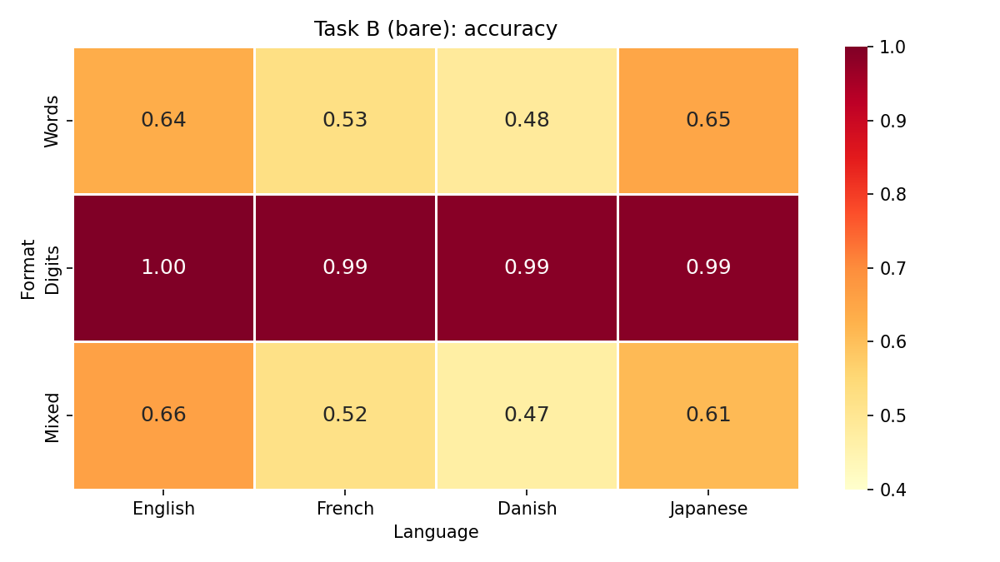

# Multilingual Prompting: Evaluation of Numerical Understanding in an Instruction-Tuned Language Model

This project revisits the probing study of [Johnson et al. (2020)](https://aclanthology.org/2020.blackboxnlp-1.18/) with a prompt-based setup. Instead of training probing classifiers on frozen embeddings of BERT, DistilBERT and XLM, an instruction-tuned model (Llama-3.1-8B-Instruct) is asked directly, zero-shot. The original word-only design is extended with Arabic digits and a mixed digit/word format.

> Term paper for the module *Advanced Topics in Computational Text and Media Science* (MA2NLP2003), M.Sc. Natural Language Processing, Trier University, Summer Semester 2026.

### Research questions

1. Do multilingual, instruction-tuned models perform better when numbers are presented as digits or as spelled-out words?
2. Can such models generalise across numeric formats, e.g. recognising that "60" and "sixty" denote the same quantity?
3. Do languages with structurally different number systems show systematically different patterns, and do they resemble those found by Johnson et al. (2020)?

---

## Key findings

- **Grammaticality (Task A) shows a three-against-one split.** English, French and Danish are more accurate with words than digits (e.g. English 0.975 vs 0.650, bare); Japanese shows the opposite (0.985 digits vs 0.635 words).
- **The stated language affects bare digit strings.** Task A bare digit accuracy ranges from 0.405 (Danish) to 0.985 (Japanese), although the digit strings carry no language-specific information. The spread narrows in sentences (0.470–0.610).
- **Value comparison (Task B) depends strongly on format.** Digits are near ceiling in every language (0.990–1.000, bare); words (0.485–0.650) and mixed pairs (0.470–0.660) are close to chance. Strong digit performance does not transfer to number words.
- **Sentence context cuts both ways.** It generally lowers digit accuracy (in Task B in every language), but raises word accuracy in Task B in every language (e.g. English 0.635 → 0.830).

## Results

Accuracy on 200 test items per condition. Full table: [`accuracy_summary.csv`](accuracy_summary.csv). All tables and figures are produced by `analyze.py` from the raw responses in [`results/`](results/).

**Task A — Is this number expression grammatical?**

| Variant | Format | English | French | Danish | Japanese |
|---|---|---|---|---|---|
| bare | words | **0.975** | 0.82 | 0.76 | 0.635 |
| bare | digits | 0.65 | 0.585 | 0.405 | 0.985 |
| sentence | words | 0.90 | 0.86 | 0.66 | 0.655 |
| sentence | digits | 0.61 | 0.565 | 0.47 | 0.575 |

**Task B — Which number is larger?** (chance = 0.50)

| Variant | Format | English | French | Danish | Japanese |
|---|---|---|---|---|---|
| bare | digits | **1.00** | **0.995** | **0.99** | **0.99** |
| bare | words | 0.635 | 0.525 | 0.485 | 0.65 |
| bare | mixed | 0.66 | 0.52 | 0.47 | 0.61 |
| sentence | digits | 0.88 | 0.81 | 0.86 | 0.92 |
| sentence | words | 0.83 | 0.675 | 0.53 | 0.82 |
| sentence | mixed | 0.71 | 0.675 | 0.585 | 0.72 |



---

## Experimental setup

| | |
|---|---|
| **Model** | `meta-llama/Meta-Llama-3.1-8B-Instruct`, temperature 0, max 10 tokens |
| **Languages** | English, French, Danish, Japanese (different number-system structures: decimal, partly vigesimal, vigesimal, kanji-based) |
| **Range** | integers 1–999 |
| **Prompting** | zero-shot, system + user prompt, one-word answer; templates in [`prompts/`](prompts/) |
| **Variants** | *bare* (number alone) vs. *sentence* (number inside a short sentence); sentences in [`templates/`](templates/) |
| **Formats** | *digits* (`60`), *words* (`sixty`), *mixed* (`60` vs. `seventy`, Task B only) |
| **Test size** | 200 items per task × language × variant × format |
| **Seed** | 42 (dataset generation is fully deterministic) |

### Tasks

**Task A — grammaticality.** Grammatical items are valid number expressions (`five hundred and two`); ungrammatical items concatenate two valid numbers (`fifty-five two hundred`). The model answers `grammatical` / `ungrammatical`.

**Task B — value comparison.** Two quantities A and B; the model answers which is larger.

---

## Reproducing the results

```bash
git clone https://github.com/<you>/multilingual-numerical-probing.git
cd multilingual-numerical-probing
python -m venv venv && source venv/bin/activate
pip install -r requirements.txt
```

Raw model outputs for every item are committed in [`results/`](results/), so the tables and figures can be rebuilt without an API key:

```bash
python analyze.py             # accuracy_summary.csv, error_analysis.json, figures/
```

To rerun everything from scratch:

```bash
cp .env.example .env          # add your DEEPINFRA_API_KEY
python generate_dataset.py    # datasets/  (deterministic, seed 42)
python evaluate.py            # results/   (skips conditions that already have results)
python analyze.py
```

`python evaluate.py --dry-run` prints example prompts without calling the API.

## Repository structure

```
├── generate_dataset.py   # builds Task A/B datasets (num2words + templates)
├── evaluate.py           # queries the model, writes results/*.jsonl
├── analyze.py            # accuracy table, error analysis, figures
├── prompts/              # system and user prompt templates
├── templates/            # sentence templates for the "sentence" variant
├── datasets/             # generated JSONL (train/val/test; only test is evaluated)
├── results/              # raw model responses per condition
├── figures/              # plots
├── accuracy_summary.csv
└── error_analysis.json   # error counts per condition, failed API calls
```

## Limitations

- **Provider change mid-study.** Most conditions were collected through Groq (`llama-3.1-8b-instant`) before its deprecation on 2026-08-16. Six conditions (the corrected Danish ones) were collected through DeepInfra, which serves the same Meta-Llama-3.1-8B-Instruct weights. Serving stacks can differ slightly even at temperature 0. Two requests failed and are counted as wrong.
- **Condition count.** The paper reports 48 conditions and 9,600 queries. Eight of these are Task A "mixed" conditions, which present the same input as "digits", so this repository reports the 40 distinct conditions (8,000 queries).
- **One model, one prompt, small test sets.** Results reflect a single 8B model, a single zero-shot prompt per task and 200 items per condition, without significance testing; smaller differences should be read with caution.
- **Number words come from `num2words`** and were not checked by native speakers. A Danish error (`treds` instead of `tres` for 60–69) was found and fixed before the final evaluation; other generator errors are possible.

## Reference

Johnson, D., Mak, D., Barker, D., & Loessberg-Zahl, L. (2020). Probing for Multilingual Numerical Understanding in Transformer-Based Language Models. *Proceedings of the Third BlackboxNLP Workshop*, 184–192.